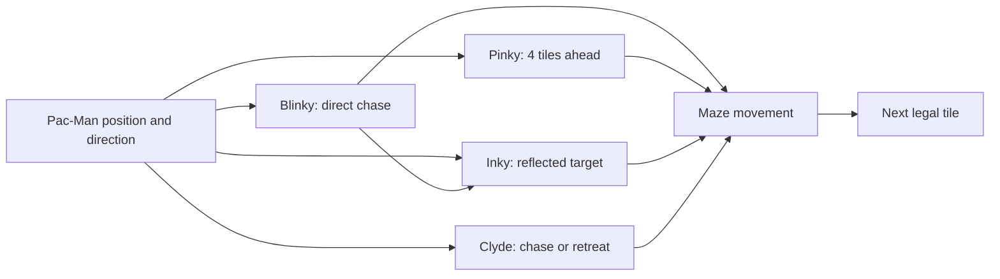

*This project has been created as part of the 42 curriculum by tlaghzal, mel-asla.*

# 🟡 PAC-MAN

<p align="center">
  <strong>Four ghosts. Four personalities. One maze at a time.</strong><br>
  A 42 Common Core project by <strong>mel-asla</strong> and <strong>tlaghzal</strong>.
</p>

<p align="center">
  
  
  
</p>

## 🎮 Description

A Python recreation of Pac-Man using the assigned MazeGenerator package.
Collect pellets, avoid ghosts, use power pellets, and complete at least ten
levels before the timer runs out. The game includes persistent top-ten
highscores, pause instructions, and cheats for evaluation.

The graphics backend is Pygame. Drawing stays in `Draw`, using images, bitmap
letters and pixel operations. This project does not run MiniLibX itself; the
comparison with Paris MiniLibX and Codam MLX42 is in [MLX.md](MLX.md).

## ✨ What we built

- **Procedural mazes:** each level uses the provided MazeGenerator, with configurable dimensions and seeds.
- **Arcade-style movement:** navigate corridors, collect pellets, and use power pellets to turn the tables on ghosts.
- **Four ghost personalities:** each ghost has its own chase target and makes decisions at maze intersections.
- **Level progression:** keep your score and remaining lives as you work through ten or more levels.
- **Local leaderboard:** save your best runs to a JSON-backed top-ten highscore table.
- **Extra controls:** pause, view instructions, and experiment with optional cheats.

We kept the README focused on the actual game systems instead of presenting
concept artwork or unused background mockups as gameplay screenshots.

## 👻 Ghost AI — four different personalities

We wanted our ghosts to feel different instead of all following the same BFS route. We kept the original Pac-Man personalities as inspiration and adapted them to our generated mazes.

| Ghost | Personality | Chase behavior |
| --- | --- | --- |
|  **Blinky** | Direct hunter | Targets Pac-Man's current tile. |
|  **Pinky** | Ambusher | Targets four tiles ahead of Pac-Man. |
|  **Inky** | Flanker | Uses Blinky's position and a point two tiles ahead of Pac-Man to calculate a reflected target. |
|  **Clyde** | Chase and retreat | Chases from a distance, then targets his corner when he gets close. |

In chase mode, each ghost chooses a legal neighboring tile closest to its own target. We avoid reversing unless necessary and break ties consistently. Frightened ghosts take random legal turns, while eaten ghosts use **BFS** to return to their spawn.

This is arcade-inspired behavior, not a frame-perfect recreation of the original Pac-Man AI.



## 🚀 Getting started

Requirements: Python 3.12 or later, [uv](https://docs.astral.sh/uv/), and a desktop
session for the game window. Run these commands from the repository root:

```sh
make install
make run
```

The subject's launch command works after activating the virtual environment:

```sh
source .venv/bin/activate
python3 pac-man.py config.json
```

The installed entry point and module launch are also available:

```sh
pac-man config.json
python3 -m src config.json
```

The window is fixed at **1800×1200**. It can extend beyond a smaller desktop;
this size was retained by request. Actor sprites scale to the maze cells.

| Command | Purpose |
| --- | --- |
| `make install` | Install the game and development tools from the lockfile |
| `make run ARGS=other.json` | Launch with a different configuration |
| `make debug` | Run the root launcher under pdb |
| `make lint` | Run Flake8 and the Mypy flags required by the subject |
| `make clean` | Remove generated Python and tool caches |

### Controls and game flow

| Input | Action |
| --- | --- |
| Arrow keys | Move; select menu choices with Up/Down |
| Enter | Confirm a menu choice or submit a name |
| P / Escape | Pause or resume gameplay |
| Backspace | Edit the name field |
| I | Toggle invincibility |
| F | Toggle ghost freeze |
| L | Add a life |
| S | Skip to the next level; the last skip reaches victory |
| H | Open the cheat guide while pausing gameplay |
| B | Refresh the power-pellet effect |
| T | Add 30 seconds to the current level timer |
| M | Add 1,000 points to the score |
| R | Reset player and ghost positions without losing a life |

The optional showcase cheats work only during active gameplay. `H` opens
paused instructions so the timer and ghosts do not continue while reading.
`B` uses the normal timed power effect; `R` clears that power when resetting
positions. Cheat bonuses intentionally affect the final leaderboard score.

Pause offers **Resume**, **Instructions**, and **Main Menu**. Instructions keep
the game paused; Enter or Escape returns to the pause choices. Losing a life
shows a short message before respawn. Game over and victory show the final
score, then allow name entry. Saving returns to the main menu. A save failure
keeps the form open so the player can correct the destination and retry.

## ⚙️ Configuration

The filename must end in `.json`. Hjson reads standard JSON plus `#`, `//` and
`/* ... */` comments outside quoted strings. Pydantic validates the settings.
Unknown keys are ignored. Missing or invalid fields produce a clear message
and use their own default, retaining other valid values. An unreadable,
malformed, or non-object file uses the full default configuration.

| Key | Default | Accepted values |
| --- | --- | --- |
| `highscore_filename` | `highscores.json` | Nonblank path without null bytes |
| `lives` | 3 | Integer ≥ 1 |
| `pacgum` | 42 | Integer ≥ 0; the game still fills at least roughly 70% of available corridors |
| `points_per_pacgum` | 10 | Integer ≥ 0 |
| `points_per_super_pacgum` | 50 | Integer ≥ 0 |
| `points_per_ghost` | 200 | Integer ≥ 0 |
| `level_max_time` | 90 | Integer seconds ≥ 1 |
| `levels` | Ten default levels | Nonempty array; padded to ten and limited to one hundred |
| `levels[].width` | 39 | Integer 5–100 |
| `levels[].height` | 29 | Integer 5–70 |
| `levels[].seed` | `null` | Positive integer or `null` |

The built-in first level uses seed 42. A first level explicitly configured with
`seed: null` also uses 42; later null seeds become random positive integers.
Explicit positive seeds are respected. Numeric settings reject booleans,
fractional values and numeric strings.

Example configuration:

```json
{
  "highscore_filename": "highscores.json",
  "lives": 3,
  "pacgum": 42,
  "points_per_pacgum": 10,
  "points_per_super_pacgum": 50,
  "points_per_ghost": 200,
  "level_max_time": 90,
  "levels": [
    {"width": 39, "height": 29, "seed": 42},
    {"width": 39, "height": 29, "seed": null},
    {"width": 39, "height": 29, "seed": null},
    {"width": 39, "height": 29, "seed": null},
    {"width": 39, "height": 29, "seed": null},
    {"width": 39, "height": 29, "seed": null},
    {"width": 39, "height": 29, "seed": null},
    {"width": 39, "height": 29, "seed": null},
    {"width": 39, "height": 29, "seed": null},
    {"width": 39, "height": 29, "seed": null}
  ]
}
```

The existing `config.json` contains only the legacy `level` key, which is
ignored; the documented defaults therefore apply. Replace its contents with
the example when configuring the game. Relative highscore paths are resolved
from the working directory.

## 🏆 Highscores

`High` stores a JSON object containing a `scores` array. Each entry has a `name`
and a nonnegative integer `score`. Names accept one to ten ASCII letters,
digits and spaces and must contain a non-space character.

Scores load when the menu starts and refresh when Highscores is opened. At game
end, a valid name and score are added, sorted descending, trimmed to ten, and
written to `highscore_filename`. Missing, empty, unreadable or invalid files
produce an empty leaderboard; file errors are reported without a traceback.

JSON keeps this small local leaderboard easy to inspect and edit, without a
database service. Writes are ordinary file writes, not transactional; possible
interruption is recorded in the [risk register](project-management/RISKS.md).

## 🧩 Maze generation

The assigned `mazegenerator-2.1.0-py3-none-any.whl` remains at the repository
root and is referenced by `pyproject.toml`. The package is used unchanged.
`Maze` calls `MazeGenerator((width, height), perfect=False, seed=seed)` and
adapts its grid for movement and rendering.

Each cell uses wall bits: north 1, east 2, south 4, west 8. The adapter converts
grid cells to window pixels and prevents movement outside the grid. The player
spawns at the walkable cell closest to the middle, avoiding blocked cells in
the generator's central motif. Ghosts and power pellets start in the corners.

Later levels use explicit random integer seeds rather than passing `None` to
the generator. A generation failure returns to the menu with an error message.
The game's ghost pathfinding navigates the supplied maze; it does not generate
or replace it.

## 🛠️ Implementation

The main loop collects events, dispatches the active screen, presents the frame,
and caps rendering at 60 FPS. Gameplay uses sixty fixed updates per second,
so movement stays consistent when rendering slows down. `GameController`
creates each level and handles
playing, pause, loss and progression. Score and remaining lives carry between
levels. Timeout ends the game. Normal completion and `S` use the same progression
path.

`Game` handles score, pellet/ghost collisions, level timing and death pauses.
We gave each ghost its own targeting strategy, as explained in the Ghost AI section above. We keep track of remaining gameplay defects in [our bug list](project-management/BUGS.md).

Pausing also stops eaten-ghost respawn, player power and the level timer.
Unexpected screen errors report their context and return to the menu; startup
failures and Ctrl+C are handled without a traceback.

The parser uses plain functions and library validation. Menu input and score
submission are separate from page drawing. The maze image and ready bitmap
rows are cached. Text uses integer scales: 1×, 2×, 3×, and so on. Two loops
draw each set bitmap pixel as a `scale × scale` square. Text that is too wide
is reduced to a smaller integer scale, then shortened if necessary. Tamzen
Bold is a pre-drawn BDF font loaded by `bdfparser`; there is no TrueType or
Pygame font rasterization.

## 🏗️ Architecture

| Module | Responsibility |
| --- | --- |
| `pac-man.py`, `src/__main__.py` | Launch, argument handling, window and event loop |
| `src/parsing/parser.py` | Read comments, recover invalid fields, normalize levels |
| `src/parsing/models.py` | Configuration constraints and defaults |
| `src/ui/state_machine.py` | Route each frame to the active menu/game handler |
| `src/ui/menu.py` | Menu selection, name editing and score submission |
| `src/ui/menu_view.py` | Main menu, highscores, instructions, victory and name layouts |
| `src/ui/game_ui.py` | Cached maze, HUD and pause/result panels |
| `src/ui/draw.py` | Image loading/placement, bitmap text and pixel primitives |
| `src/ui/content.py`, `src/ui/theme.py` | Shared instructions and colors |
| `src/game_controller.py` | Connect gameplay objects and screen transitions |
| `src/maze.py` | Adapt the assigned generator and movement coordinates |
| `src/game/` | Player, ghosts, pellets, score, timing, cheats and persistence |
| `src/resources.py`, `src/assets/` | Resolve and store the resources used at runtime |

Dependencies flow from the launcher to configuration and the state machine.
The state machine selects `Menu` or `GameController`; they ask their views and
`Draw` to display content. Gameplay classes own their state, and `High` owns
leaderboard persistence.

Assets are organized once under `src/assets/`: backgrounds, ghosts, player,
walls and fonts. The bitmap-font license is bundled. See the
[cleanup inventory](project-management/CLEANUP.md) for the 48 retained files and
removed duplicate resources.

## 📋 Project management

The [project-management directory](project-management/README.md) contains the
commit-based timeline, observed contributions, technical decisions, risks,
acceptance procedures, open bugs and cleanup record. The timeline covers work
visible from 4 to 25 October 2026. It is a retrospective record, not a claim
that the team had an earlier formal schedule or meeting log.

`make lint`, parser edge cases, menu/save flows, selected ghost behavior and
all ten level skips have been checked. A complete manual playthrough, root
packaging script/spec, standalone distribution test and free unlisted/private
platform release remain pending. Detailed scope and results are in
[ACCEPTANCE.md](project-management/ACCEPTANCE.md).

## 📚 Resources

- [Project subject](en.subject.pdf)
- [Pygame documentation](https://www.pygame.org/docs/)
- [Pydantic documentation](https://docs.pydantic.dev/)
- [Hjson syntax](https://hjson.github.io/syntax.html)
- [bdfparser](https://github.com/tomchen/bdfparser)
- [Tamzen bitmap font and license](https://github.com/sunaku/tamzen-font)
- [42 Paris MiniLibX API](https://github.com/42Paris/minilibx-linux/blob/master/mlx.h)
- [Codam MLX42 API](https://github.com/codam-coding-college/MLX42/blob/master/include/MLX42/MLX42.h)

During development, we used AI as a learning resource for game loops, state machines,
configuration validation, and bitmap graphics.
